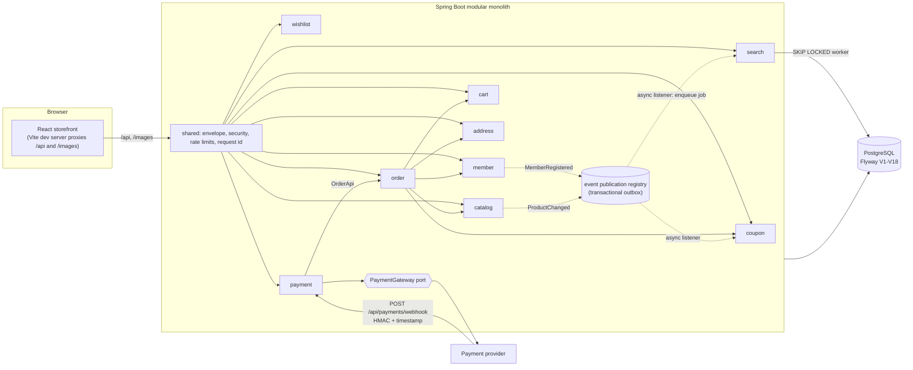

# LUNEPICK (루네픽)

A health & beauty storefront with a Spring Boot modular-monolith backend: catalog, search, cart, wishlist, coupons, points, orders and payments, built around correctness under concurrency rather than feature count.

**Live demo:** https://gyeol-market.vercel.app (storefront only, see below)

## Background

- **Storefront** (`frontend/`, React 18 + Vite + TanStack Query): the original repository was lost, so the storefront was recovered from its 2026-10-10 Vercel deployment and imported unchanged (first commit, `c67b833`).
- **Backend** (`src/`, Java 21, Spring Boot 4.1.2, Spring Modulith 2.1.2, PostgreSQL): rebuilt from scratch to serve exactly the API the recovered storefront calls. All 30 storefront operations are implemented, plus a payment-provider webhook. Shared JSON fixtures in [`contract/`](contract/README.md) pin the wire format on both sides.
- **Demo:** the public site runs the storefront's in-browser mock API (`npm run build:demo`). The backend is not hosted anywhere.

## Architecture



Ten Modulith modules live under `src/main/java/io/github/cskwork/lunepick/`. Each exposes a small root-level API (`OrderApi`, `CatalogStockApi`, `CouponApi`, ...) or an event; implementation stays in `internal`, and `ModuleArchitectureTest` fails the build on boundary violations. Details: [docs/architecture.md](docs/architecture.md).

## Key engineering decisions

| Decision | Where |
| --- | --- |
| **Idempotent order creation.** `INSERT ... ON CONFLICT (member_id, idempotency_key) DO NOTHING RETURNING *`. The same key with the same canonical body replays the stored response; a different body returns 409 `IDEMPOTENCY_CONFLICT`. Concurrent duplicates wait on the unique constraint instead of racing. | [`order/internal/persistence/OrderStore.java`](src/main/java/io/github/cskwork/lunepick/order/internal/persistence/OrderStore.java), [ADR 0002](docs/adr/0002-idempotent-order-creation.md) |
| **Reservations without overselling or deadlocks.** Every checkout, confirm and expiry path takes locks in one order: order row, member points (conditional `UPDATE ... WHERE balance - reserved >= amount`), stock rows sorted by option id (`FOR UPDATE`), then coupon. Unlimited stock takes only a shared lock and is never rewritten. | [`order/internal/application/OrderService.java`](src/main/java/io/github/cskwork/lunepick/order/internal/application/OrderService.java), [`catalog/internal/application/StockService.java`](src/main/java/io/github/cskwork/lunepick/catalog/internal/application/StockService.java) |
| **Payment capture last.** All local settlement is written before the gateway call, which is the last step before commit. If a captured transaction rolls back, an `afterCompletion` callback cancels at the provider and records a `NEEDS_REVIEW` case in its own transaction; ambiguous outcomes also hold the order out of expiry. | [`payment/internal/application/PaymentService.java`](src/main/java/io/github/cskwork/lunepick/payment/internal/application/PaymentService.java), [ADR 0003](docs/adr/0003-payment-capture-last.md) |
| **Rotating refresh tokens.** Opaque tokens stored as SHA-256 hashes, rotated under a pessimistic family lock; replay outside a 3-second grace window revokes the whole family. Access tokens are RS256 JWTs checked against a live session on every request. | [`member/internal/application/AuthTransactions.java`](src/main/java/io/github/cskwork/lunepick/member/internal/application/AuthTransactions.java), [ADR 0004](docs/adr/0004-refresh-token-rotation.md) |
| **Outbox plus a coalescing job queue.** Spring Modulith's JDBC event registry is the outbox, with bounded retries and a dead-letter table. Search indexing coalesces into one pending job per product (partial unique index) and is drained by a `FOR UPDATE SKIP LOCKED` worker with backoff and a `DEAD` state. | [`shared/internal/maintenance/OutboxMaintenance.java`](src/main/java/io/github/cskwork/lunepick/shared/internal/maintenance/OutboxMaintenance.java), [`search/internal/application/SearchIndexWorker.java`](src/main/java/io/github/cskwork/lunepick/search/internal/application/SearchIndexWorker.java), [ADR 0001](docs/adr/0001-modulith-with-transactional-outbox.md), [ADR 0005](docs/adr/0005-search-index-job-queue.md) |
| **Real PostgreSQL in tests, no Docker.** Integration tests run against an embedded PostgreSQL 14.22.0 process (zonky binaries) with a fresh database per test class, so Flyway migrations, row locks and `SKIP LOCKED` behave as in production. | [`src/test/.../integration/EmbeddedDatabase.java`](src/test/java/io/github/cskwork/lunepick/integration/EmbeddedDatabase.java), [ADR 0006](docs/adr/0006-embedded-postgresql-tests.md) |

## Run locally

Requirements: Java 21, Node 22, and a local PostgreSQL (Homebrew, apt or the official installer; no Docker). The first migration runs `CREATE EXTENSION IF NOT EXISTS pg_trgm`, so the database user needs permission to create it.

```bash
# 1. Database (local profile defaults: jdbc:postgresql://localhost:5432/lunepick, user postgres)
createdb lunepick

# 2. Backend: build, test and start with the local profile on :8080
./mvnw -B verify
java -jar target/lunepick-0.1.0-SNAPSHOT.jar --spring.profiles.active=local

# 3. Storefront against the backend (proxies /api and /images to :8080)
cd frontend && npm ci && npm run dev      # open http://localhost:5173/app/
```

The `local` profile generates ephemeral RSA signing keys, uses development webhook and refresh-cipher secrets, enables the `FakePaymentGateway`, and creates a demo member (`demo@example.com` / `demo1234`). Override the database with `LUNEPICK_DB_URL`, `LUNEPICK_DB_USER` and `LUNEPICK_DB_PASSWORD`, and the proxy target with `VITE_API_PROXY_TARGET`.

Any other profile refuses to start without real secrets: `LUNEPICK_AUTH_PRIVATE_KEY` / `LUNEPICK_AUTH_PUBLIC_KEY` (RSA PEM, 2048+ bits), `LUNEPICK_AUTH_ISSUER`, `LUNEPICK_REFRESH_CIPHER_SECRET` (base64 of 32 random bytes), `LUNEPICK_PAYMENT_WEBHOOK_SECRET`, and a real `PaymentGateway` adapter (none ships with the repo).

**Demo-only mode** (no backend, in-browser mock API, as deployed on Vercel):

```bash
cd frontend && npm ci && npm run dev:demo      # or: npm run build:demo
```

## Testing

Results of one full run on **2026-10-28** (uncommitted working tree on `feat/backend-foundation`):

| Suite | Command | Result |
| --- | --- | --- |
| Backend, all layers | `./mvnw -B clean verify` | **366 tests, 0 failures, 0 errors, 0 skipped**, BUILD SUCCESS |
| &nbsp;&nbsp;integration (embedded PostgreSQL) | | 127 |
| &nbsp;&nbsp;application services | | 106 |
| &nbsp;&nbsp;domain | | 49 |
| &nbsp;&nbsp;web | | 45 |
| &nbsp;&nbsp;configuration, security, persistence and other | | 37 |
| &nbsp;&nbsp;architecture (Modulith boundaries) | | 2 |
| Line coverage (JaCoCo, gated packages) | part of `verify` | **98.5%** (1,916 / 1,945 lines); build gate is 80% |
| Formatting | part of `verify` (Spotless, google-java-format AOSP) | pass |
| Frontend unit and contract tests | `cd frontend && npm test` | **160 passed, 0 failed, 0 skipped** (7 files) |
| Frontend typecheck and builds | `npm run typecheck`, `npm run build`, `npm run build:demo` | pass |
| Dependency audit | `npm audit` | 0 vulnerabilities |
| End-to-end smoke | `scripts/smoke_checkout.py` (local PostgreSQL, packaged jar, Vite proxy) | pass: 30/30 storefront routes, payment 422/200, expiry release, 409 after expiry, signed webhook review, 429 with `Retry-After` |

Coverage is gated on the `internal/application`, `domain`, `persistence`, `infrastructure` and `maintenance` packages (see `pom.xml`). No test uses Docker or Testcontainers.

CI ([`.github/workflows/ci.yml`](.github/workflows/ci.yml)) runs `./mvnw -B verify` and the frontend checks (`npm ci`, `npm audit`, typecheck, tests, both builds) on pull requests and on pushes to `main`. It has not run yet, so no CI result is claimed here.

## Limitations

- **Payments are faked.** Only `FakePaymentGateway` exists (local/test profiles). A real adapter must provide idempotent confirm/cancel, bounded timeouts and provider reconciliation. Paid refunds are not implemented.
- **Backend is not hosted.** The live demo exercises the storefront and its mock API only; the mock allows looser numeric input, has unlimited seed inventory, no distributed rate limiter and no webhook.
- **Single region, single database.** Rate limits, locks and the outbox all rely on one PostgreSQL instance.
- **Payment confirmation holds a DB connection and the order row lock during the provider call.** Pool sizing and provider timeouts must account for that; a two-phase pending-capture design is the documented alternative.
- **`NEEDS_REVIEW` cases need an operator.** There is no admin UI; held orders stay reserved until someone reconciles and releases them.
- **The storefront has no guest cart**, so `/api/cart/merge` always merges zero items.

More operational detail: [docs/backend-notes.md](docs/backend-notes.md). Module diagrams: [docs/modules](docs/modules/all-docs.adoc).

## 한국어 요약

루네픽은 헬스·뷰티 커머스(카탈로그, 검색, 장바구니, 쿠폰, 주문, 결제) 프로젝트입니다. 원래 저장소가 유실되어 React 스토어프런트는 2026-10-10 Vercel 배포본에서 복구했고, 백엔드는 그 스토어프런트가 호출하는 API에 정확히 맞춰 Java 21·Spring Boot 4·Spring Modulith·PostgreSQL로 새로 만들었습니다. 핵심은 동시성 정합성입니다. 멱등 주문 생성, 고정된 락 순서로 하는 재고·포인트·쿠폰 예약, 결제 승인을 커밋 직전 마지막에 호출하고 롤백 시 보상 및 `NEEDS_REVIEW` 기록, 리프레시 토큰 회전과 패밀리 폐기, 아웃박스와 `SKIP LOCKED` 검색 색인 큐를 구현했습니다. 2026-10-28 기준 백엔드 테스트 366개, 프런트엔드 테스트 160개가 모두 통과했고 라인 커버리지는 98.5%입니다. 공개 데모는 브라우저 내 목 API로 동작하며 백엔드는 호스팅하지 않습니다.
