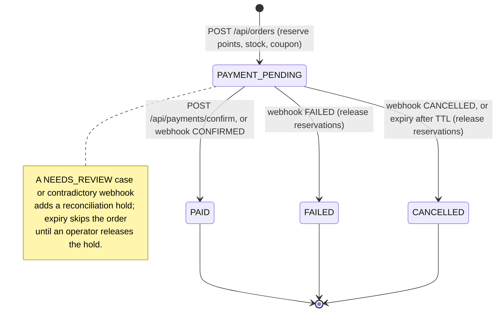

# Architecture

LUNEPICK is one Spring Boot 4.1.2 application (Java 21) organised as a Spring Modulith 2.1.2 modular monolith over one PostgreSQL database. The React storefront in `frontend/` talks to it only through `/api` (JSON envelope) and `/images` (seed product images). This page covers the parts a reviewer is most likely to ask about; the full operational reference is [backend-notes.md](backend-notes.md), and the decisions behind it are in [adr/](adr/README.md).

All Java paths below are relative to `src/main/java/io/github/cskwork/lunepick/`.

## Modules and their public surface

Each module keeps implementation under `internal/`; other modules may only use the root-level types listed here. `src/test/java/.../architecture/ModuleArchitectureTest.java` verifies this with Spring Modulith and ArchUnit, and generated diagrams are kept in [modules/](modules/all-docs.adoc).

| Module | Public API (root package) | Publishes | Consumes |
| --- | --- | --- | --- |
| `catalog` | `CatalogApi` (search snapshots, product summaries), `CatalogStockApi` (option snapshots, `reserve`, `release`) | `ProductChanged(productId)` | - |
| `search` | `SearchApi` (search, autocomplete, popular) | - | `CatalogApi`; listens to `ProductChanged` |
| `member` | `MemberApi` (member lookup, `availablePoints`, `reservePoints`, `settlePoints`, `releasePoints`) | `MemberRegistered(memberId)` | - |
| `coupon` | `CouponApi` (`list`, `reserve`, `redeem`, `release`, `usableCount`) | - | listens to `MemberRegistered` (welcome coupons) |
| `cart` | `CartApi` (`selectedItemIds`, `clearPurchased`) | - | `CatalogStockApi`, `CatalogApi` |
| `address` | `AddressApi` (`owned`) | - | - |
| `wishlist` | `WishlistApi` (`list`, `add`, `remove`) | - | `CatalogApi` |
| `order` | `OrderApi` (`paymentTarget`, `confirm`, `fail`, `holdForReconciliation`) | - | `CatalogStockApi`, `MemberApi`, `CartApi`, `AddressApi`, `CouponApi` |
| `payment` | none (HTTP only); `internal/application/PaymentGateway` is the provider port | - | `OrderApi` |
| `shared` | `ApiResponse`, `ApiException`, `PageQuery`, `PageMeta`, `WebPolicyContributor` | - | - |

`shared` owns the platform: response envelope and error handler, `SecurityConfiguration`, the Bucket4j rate-limit filter, `RequestIdFilter`, SPA hosting at `/app/`, and outbox maintenance. Modules contribute their own public routes, rate budgets and ETag paths through `WebPolicyContributor`, so `shared` never lists business routes.

Persistence style: JPA for member/session aggregates; `JdbcClient` with record mappings for catalog and commerce reads and set-based updates; `JdbcTemplate` for queue claims. Schema is managed by Flyway (`src/main/resources/db/migration`, V1 to V18; there is no V15), with `ddl-auto: validate` and open-in-view disabled. Money is `BigDecimal`, time is UTC `Instant` from an injected `Clock`.

## Transactions and locking

**Checkout** (`order/internal/application/OrderService.create`) runs in one transaction:

1. `INSERT INTO orders ... ON CONFLICT (member_id, idempotency_key) DO NOTHING RETURNING *`. No row returned means a previous attempt exists: same canonical body replays its response, different body returns 409 `IDEMPOTENCY_CONFLICT`. A concurrent duplicate waits on the unique index until the first transaction commits or rolls back.
2. Points: `UPDATE members SET reserved_points = reserved_points + :amount WHERE id = :id AND point_balance - reserved_points >= :amount` (`member/internal/persistence/JdbcMemberPointsStore.java`).
3. Stock: option ids are merged and sorted (`TreeMap`), each finite option is locked with `SELECT ... FOR UPDATE OF o FOR SHARE OF p`, checked, then decremented (`catalog/internal/application/StockService.java`). Unlimited options (`available_quantity IS NULL`) take only `FOR SHARE OF o, p` to validate sale status and are never rewritten; if an option turned finite while waiting, the reservation fails rather than upgrading a shared lock.
4. Coupon reservation, pricing (`order/internal/domain/OrderPricing.java`), price/option/address snapshots and the cart lines to clear.

**Lock order.** Every path that touches reservations acquires locks in the same order, which is what prevents deadlocks between checkout, confirmation, webhooks and expiry:

```text
order row  ->  member points  ->  product options (ascending option id)  ->  member coupon
```

Confirmation, webhook and expiry first lock the order row (`OrderApi.paymentTarget` / `OrderStore.byOrderNo(..., true)`), then settle or release in the same order. Wishlist and address writes serialise per member with `pg_advisory_xact_lock`.

## Order and payment state machine

### Order numbers

`OrderService.create` builds `YYYYMMDD-<order id>` using the UTC application clock and
the PostgreSQL-generated order ID. Sequences allocate unique, increasing values;
allocations are not rolled back. Failed checkouts and idempotent replay attempts can
therefore leave gaps, such as `20261028-2` followed by `20261028-6`. Numbers are unique
and ordered by allocation, not dense or necessarily ordered by transaction commit.
The sequence is global, not a daily counter. The storefront treats `orderNo` as an
opaque display and lookup string; neither it nor the demo requires consecutive values.

### States

Order statuses come from the `orders.status` check constraint (`V6__orders.sql`). `NEEDS_REVIEW` is not an order status: it is a state of a webhook event row (`payment_webhook_events`) or a `payment_reconciliation_cases` row, and it places a hold in `order_reconciliation_holds` that keeps the order out of expiry.



**Payment confirmation** (`payment/internal/application/PaymentService.confirm`):

1. Lock the order and validate member, payment key and amount (mismatch: 422 `PAYMENT_AMOUNT_MISMATCH`).
2. Insert a `payment_confirmations` row with `ON CONFLICT DO NOTHING`; a duplicate replays the committed result.
3. Settle points, redeem the coupon, clear purchased cart lines, mark the order `PAID`.
4. Register an `afterCompletion` synchronization, then call `PaymentGateway.confirm` as the last operation.
5. Outcomes: explicit `DECLINED` rolls back with no review case. `UNKNOWN` (timeout/transport) attempts a best-effort provider cancel and records `NEEDS_REVIEW` plus a hold in an independent transaction (`payment/internal/infrastructure/PaymentReconciliationRecorder.java`). If capture succeeded but the transaction rolls back (for example a deferred constraint fails at commit), the callback cancels at the provider and records a review case (`CaptureRollbackCompensator.java`). If the commit outcome is unknown, it records a review case without cancelling, because the commit may have succeeded.

Trade-off: the order row lock and a pooled connection are held during the provider call. A real adapter needs bounded timeouts, capped concurrent captures, and pool headroom for the independent review transactions. See [ADR 0003](adr/0003-payment-capture-last.md).

**Webhook** (`POST /api/payments/webhook`, `payment/internal/web/PaymentController.java`): body capped at 16,384 bytes and rate-limited per IP. `X-PG-Signature` is a hex HMAC-SHA256 over `X-PG-Timestamp` + `.` + raw body; timestamps more than 5 minutes off are rejected (`payment/internal/domain/WebhookSignature.java`). Event ids deduplicate retries; the same id with a different body hash returns 409. Amount/key mismatches and contradictory transitions (for example `FAILED` after `PAID`) are stored as `NEEDS_REVIEW`, acknowledged with 200, logged at WARN, and counted by `lunepick.payment.webhook.needs_review` after commit.

## Scheduled jobs

| Job | Implementation | Behaviour | Defaults |
| --- | --- | --- | --- |
| Checkout expiry | `order/internal/config/OrderExpiryConfiguration.java`, `OrderService.expirePending` | Claims one `PAYMENT_PENDING` order older than the TTL with `FOR UPDATE OF o SKIP LOCKED`, skips held orders, releases reservations and sets `CANCELLED`, one `REQUIRES_NEW` transaction per order. A failure rolls back that order only, records `expiry_attempts` / `expiry_next_attempt_at` / `expiry_last_error` in a separate transaction with exponential backoff, and moves on. | TTL 30 min, batch 100, every 1 min, retry 30 s up to 1 h |
| Outbox retry | `shared/internal/maintenance/OutboxMaintenance.java` | Guarded by `pg_try_advisory_xact_lock`; marks stale claims failed, resubmits failed publications, moves those past the attempt limit to `event_publication_dead_letters` (`DEAD`) and increments `lunepick.outbox.publications.dead`. | retry age 30 s, stale after 5 min, batch 50, 4 in flight, 5 attempts |
| Search indexing | `search/internal/application/SearchIndexWorker.java` | Claims one `QUEUED`/`RETRY` job with `FOR UPDATE SKIP LOCKED` in its own transaction; projection writes use a nested transaction so a failure can be recorded as `RETRY` or `DEAD` with exponential backoff. | every 1 s, 3 attempts, backoff 1 s to 1 min |
| Replay-key cleanup | `OrderService.forgetExpiredReplayKeys` | Clears idempotency keys of terminal orders; order history is kept. | 24 h retention, hourly |
| Webhook retention | `payment/internal/config/PaymentMaintenance.java` | Deletes `PROCESSED` webhook events; `NEEDS_REVIEW` rows are kept. | 30 days, hourly |
| Refresh-family cleanup | `member/internal/application/RefreshCleanup.java` | Clears expired grace ciphertext and deletes families 1 day after expiry/revocation, batched with `SKIP LOCKED`. | batch 500, every 60 s |
| Search job retention / metrics | `SearchIndexWorker` | Deletes `COMPLETED` jobs; refreshes an in-memory gauge snapshot so scrapes do not query the database. | 7 days, hourly / 30 s |
| Rate-limit and login-failure cleanup | `shared/internal/application/RateLimitService.java`, `member/internal/application/LoginFailureGuard.java` | Removes old windows. | every 5 min (rate limit) |

## Events

The Spring Modulith JDBC event publication registry is the transactional outbox: events are stored in the publishing transaction and delivered after commit to `@ApplicationModuleListener` methods on a bounded executor (4 threads, queue 64). Delivery is at least once, so consumers are idempotent:

- `MemberRegistered` -> `coupon/internal/application/WelcomeCoupons.java` issues welcome coupons with `ON CONFLICT (member_id, coupon_id) DO NOTHING`.
- `ProductChanged` -> `search/internal/application/SearchIndexJobs.java` upserts one pending job per product (`ON CONFLICT (product_id) WHERE status IN ('QUEUED','RETRY')`). `StockService` only publishes when a finite option flips between in stock and sold out.

Completed publications are deleted (`completion-mode: delete`) and restart republishing is disabled; the retry job above is the only resubmission path. See [ADR 0001](adr/0001-modulith-with-transactional-outbox.md) and [ADR 0005](adr/0005-search-index-job-queue.md).

## Security

- **Access tokens:** RS256 JWTs with issuer, audience (`lunepick-api` by default) and expiry (`member/internal/application/AuthService.java`, `member/internal/config/AuthConfiguration.java`). Each authenticated request also checks the database session, so logout and reuse revocation take effect immediately on every instance.
- **Refresh tokens:** random opaque values stored as SHA-256 hashes. Rotation locks the family (`PESSIMISTIC_WRITE`). Replaying the immediately previous token within `refresh-reuse-grace` (3 s, allowed 0 to 10 s) returns the same successor from an AES-GCM encrypted copy; any other replay revokes the family. See [ADR 0004](adr/0004-refresh-token-rotation.md).
- **Passwords:** `DelegatingPasswordEncoder` (PBKDF2 for new hashes, bcrypt accepted), run outside database transactions with bounded concurrency.
- **Rate limits:** Bucket4j with PostgreSQL storage. Default budgets per window (1 min): login 30 per IP and 10 per IP+email, signup 10 per IP, order creation 20 per member, payment confirmation 30 per member, plus a webhook IP budget. A separate failure-only guard cools down an email after 100 invalid-credential failures in 60 s from at least 3 distinct IPs. Exhaustion returns 429 with `Retry-After`; limiter storage failure returns 503.
- **Trusted proxies:** native Tomcat forwarded-header handling with `internal-proxies` defaulting to `(?!)` (trust nothing). Production sets `LUNEPICK_TRUSTED_PROXIES` to the exact ingress addresses; the local profile trusts loopback only, for the Vite proxy.
- **Webhook:** HMAC-SHA256 over timestamp and raw body, 5-minute clock window, event-id dedupe with body hash.
- **Errors:** no stack traces or messages from Spring's default error page; unexpected exceptions are logged with their throwable and request id but never the request body.

## Observability

- `RequestIdFilter` accepts or generates `X-Request-Id`, returns it, and puts it in the MDC; logs use ECS structured JSON.
- Health is public at `/actuator/health` on the main port. Metrics and Prometheus are only exposed on a separate management listener (`LUNEPICK_MANAGEMENT_PORT`, disabled by default, bound to `127.0.0.1` unless `LUNEPICK_MANAGEMENT_ADDRESS` is set). Customer JWTs cannot read metrics on the main port.
- Custom meters: `lunepick.payment.webhook.needs_review`, `lunepick.outbox.publications.dead`, `lunepick.search.index.jobs` (by status), `lunepick.search.index.processed`, `lunepick.search.index.failed`.

## Configuration and profiles

| Profile | Purpose | Notable behaviour |
| --- | --- | --- |
| `local` | Developer machine | Database defaults to `jdbc:postgresql://localhost:5432/lunepick` as `postgres`; ephemeral RSA keys; development webhook and refresh-cipher secrets; `FakePaymentGateway`; demo member `demo@example.com`; trusts loopback proxies. |
| `test` | Automated tests | Same development fallbacks as `local`; database supplied by the embedded PostgreSQL test harness. |
| `prod` | Deployment | Requires `LUNEPICK_DB_URL/USER/PASSWORD`, `LUNEPICK_AUTH_ISSUER`, `LUNEPICK_AUTH_PRIVATE_KEY`, `LUNEPICK_AUTH_PUBLIC_KEY`, `LUNEPICK_REFRESH_CIPHER_SECRET`, `LUNEPICK_PAYMENT_WEBHOOK_SECRET`; Swagger UI and API docs off unless `LUNEPICK_SWAGGER_UI_ENABLED` / `LUNEPICK_API_DOCS_ENABLED`. No fake gateway is registered, so a real `PaymentGateway` bean must be provided. |

Outside `local`/`test`, startup fails fast if signing keys, the refresh cipher secret or the webhook secret are missing or equal to the development values. Platform defaults (`src/main/resources/application.yml`): virtual threads on, Hikari pool 20, scheduler pool 3, graceful shutdown. All `lunepick.*` tuning keys and defaults are listed in [backend-notes.md](backend-notes.md#events-search-and-retention).

## Frontend integration

`frontend/vite.config.ts` has two targets. The default build is served by Spring Boot at `/app/` (output `src/main/resources/static/app`), and the dev server proxies `/api` and `/images` to `VITE_API_PROXY_TARGET` (default `http://localhost:8080`). `VITE_DEMO=1` (`npm run dev:demo`, `npm run build:demo`) builds a standalone site at `/` with the in-browser mock in `frontend/src/demo` and bundled seed images; this is what the public demo serves. The wire format is pinned by [`contract/`](../contract/README.md) fixtures, checked by backend integration tests and by `frontend/src/lib/backend-contract.test.ts`.
