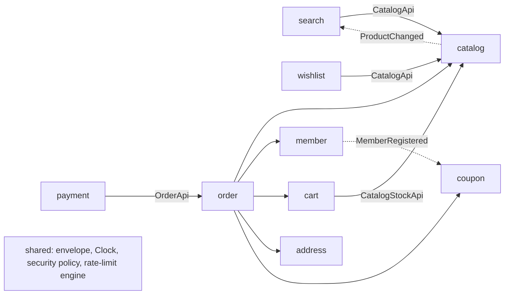

# Backend engineering notes

Operational reference for the backend. Start with the [README](../README.md) and [architecture overview](architecture.md); design rationale is in the [ADRs](adr/README.md).

The backend is a Java 21, Spring Boot 4.1.2 modular monolith backed by PostgreSQL. The React storefront defines the public response envelope and the fields its pages consume. All 30 storefront operations are implemented; the payment webhook is an additional provider endpoint.

## Storefront read fields

`GET /api/cart` includes each line's `productId` and nullable `thumbnailUrl`, using
the catalog's product ID and thumbnail selection. Options and product summaries are
loaded in bulk. Hidden or unavailable catalog summaries leave the thumbnail null;
the line retains its option status and product identity for checkout validation.
The product route is `/products/{productId}`; there is no product slug contract.

`GET /api/me/summary` includes `name` from the authenticated member record alongside
available points, coupon and order counts, and grade. These fields extend the demo's
original cart and summary shapes; clients can consume them without extra detail requests.

Both `/app` and `/app/` return the built HTML entry directly. Non-asset deep links
use the same entry; missing assets remain 404. The frontend build must be installed
under `static/app` for hosted mode.

Free-shipping coupons require the product subtotal to meet their minimum before
points are deducted. They waive the delivery fee without reducing product prices;
points then reduce the remaining payable amount and cannot exceed it. The seeded
coupon requires 15,000 won; ordinary free shipping starts at a 30,000-won subtotal.
Order-number gaps are expected, as described in [architecture.md](architecture.md#order-numbers).

## Modules and boundaries

Implementation classes live under each module's `internal` package. Other modules call root-level APIs or publish immutable events.

Modules contribute public request matchers, credential-endpoint bearer behavior, rate budgets and ETag paths through `shared.WebPolicyContributor`. The platform does not enumerate business routes. Protected routes require an active member session. Ownership failures return 404.

JPA loads and modifies member/session aggregates. Catalog and commerce read models and set-based updates use JDBC with named record mappings, chiefly `JdbcClient`. Queue infrastructure uses `JdbcTemplate` for transactional claims and nested updates. Money uses `BigDecimal`, timestamps use UTC `Instant`, and open-in-view is disabled. Catalog lists batch their related data; cart and wishlist enrich all visible lines in bulk. Wishlist additions serialize per member and enforce `lunepick.wishlist.max-entries` (default 500, allowed 1..5000); exceeding the limit returns 409 `WISHLIST_LIMIT_REACHED`. Reads also cap legacy data at that bound. Hidden catalog products are excluded from public lists, search snapshots and wishlist totals.

`ModuleArchitectureTest` checks Modulith boundaries and internal dependency direction. It writes generated diagrams to `target/modulith-docs`. To update the reviewed copy in `docs/modules`, explicitly run `python3 scripts/export-module-docs.py`.

## HTTP operations

Responses use `{success,data?,meta?,error?}`. Absent envelope fields are omitted; nested DTO nulls retain their meaning. Pagination is zero-based with integer page >= 0 and size 1..100. Invalid, fractional, nonfinite, radix and exponent inputs return 400. The browser sends ordinary decimal integers. Category and brand IDs must be positive decimal integers when supplied.

| Module | Operations |
| --- | --- |
| catalog (7) | GET `/api/categories`, `/api/categories/{id}/products`, `/api/products`, `/api/products/rankings`, `/api/products/best-sellers`, `/api/products/{id}`, `/api/products/{id}/reviews` |
| search (3) | GET `/api/search/products`, `/api/search/autocomplete`, `/api/search/popular` |
| member (4) | POST `/api/auth/signup`, `/api/auth/login`, `/api/auth/refresh`, `/api/auth/logout` |
| cart (5) | GET `/api/cart`; POST `/api/cart/items`; PATCH/DELETE `/api/cart/items/{id}`; POST `/api/cart/merge` |
| address (2) | GET/POST `/api/me/addresses` |
| coupon (1) | GET `/api/me/coupons` |
| wishlist (3) | GET/POST `/api/me/wishlist`; DELETE `/api/me/wishlist/{productId}` |
| order (4) | POST/GET `/api/orders`; GET `/api/orders/{orderNo}`; GET `/api/me/summary` |
| payment (1) | POST `/api/payments/confirm` |

The recovered browser has no anonymous-cart write operation. `/api/cart/merge` therefore returns zero merged items; there are no guest staging tables. Cart quantity PATCH sets an absolute quantity in one owner-qualified UPDATE. Address creation handles the default address atomically.

The normal frontend build is served at `/app/`. Non-asset deep links resolve to the built entry point; missing assets stay 404. The development server proxies `/api` and `/images` using `VITE_API_PROXY_TARGET`. The standalone demo build includes its seed images and requires no backend.

## Checkout and payments

Order creation captures price, option, address and cart snapshots. Conditional stock updates prevent overselling; point and coupon reservations participate in the same transaction. The public point balance is the available balance, subtracting all pending reservations.

`Idempotency-Key` is scoped to a member. A canonical typed body replays the stored order response; a different body with the same live key returns 409 `IDEMPOTENCY_CONFLICT`. Concurrent requests serialize on the unique member/key constraint. Terminal orders retain their history after replay keys expire, and a new request may reuse an expired key.

A pending checkout expires to `CANCELLED`, which the storefront already renders. The expiry worker claims one old order with `FOR UPDATE SKIP LOCKED`, releases its reservations, and commits before claiming the next order, up to the configured batch size. Each order uses its own transaction and follows member → stock → coupon locking. A failed release rolls back that order, records retry metadata in an independent transaction, and continues with later orders. Exponential backoff prevents a poison order from monopolizing future batches. `lunepick.order.expiry.retry.delay` defaults to 30 seconds and `.max-delay` to one hour; `expiry_attempts`, `expiry_next_attempt_at` and `expiry_last_error` preserve the operational evidence without releasing reservations from a failed attempt. Unlimited inventory performs no stock UPDATE; a shared read lock validates its sale status through reservation commit. Confirm, webhook and expiry lock the order before changing its state, so reservations settle or release once.

`PaymentGateway` defines provider confirm/cancel operations and distinguishes explicit `DECLINED` from transport/timeout `UNKNOWN` failures. A decline rolls back locally without a reconciliation case. An unknown capture outcome attempts best-effort cancellation and records `NEEDS_REVIEW` independently before the local transaction rolls back. `FakePaymentGateway` is available only in local/test profiles; production requires a real adapter with provider-side idempotency. All local settlement changes and the payment confirmation row are prepared before the gateway capture, which is the last operation before commit. If a captured attempt rolls back, an `afterCompletion(STATUS_ROLLED_BACK)` callback cancels at the provider best effort and records a durable `NEEDS_REVIEW` case in a separate transaction. Unknown commit outcomes record a separate review case for provider reconciliation and do not automatically cancel, because a database commit may actually have succeeded. If the database is unavailable, review persistence can also fail and emits an ERROR without masking the original failure. Amount mismatch returns 422 `PAYMENT_AMOUNT_MISMATCH`. The adapter must support idempotent confirm/cancel and provider reconciliation after ambiguous network or commit outcomes.

Confirmation holds a database connection and the order row lock throughout the provider call. A real adapter must use bounded connection/read timeouts for both capture and compensating cancellation, cap concurrent captures, and size the database pool for that in-flight work, including spare connections for independent reconciliation transactions while an outer capture transaction is still active; a slow provider can otherwise exhaust connections and block operations on the same order. A larger integration could use a two-phase pending-capture state: commit a durable capture request, call the provider outside the order transaction, then settle its idempotent result in a second transaction. That design needs reconciliation for the gap between provider approval and local settlement.

Pending orders with open payment reconciliation are held out of expiry through an order-owned reconciliation hold. Recording a case and its hold is one independent transaction; the hold has no order-row foreign key, so recording an ambiguous result cannot deadlock against the capture transaction’s existing order lock. Expiry rechecks the hold after locking the order. An operator must reconcile the provider outcome and explicitly release the hold before normal expiry resumes; reservations remain held during review.

The provider callback is `POST /api/payments/webhook`, capped at 16,384 bytes and protected by an IP budget. Send Unix epoch seconds as `X-PG-Timestamp` and a hexadecimal HMAC-SHA256 as `X-PG-Signature`. The signed bytes are the exact timestamp, a period, then the raw UTF-8 body. The accepted clock difference is at most 300 seconds.

Webhook JSON contains `eventId`, `orderNo`, `paymentKey`, `amount` and `status` (`CONFIRMED`, `FAILED` or `CANCELLED`). A unique event ID deduplicates retries, and the body hash rejects changed payloads for the same ID. Contradictory terminal events, including FAILED/CANCELLED after PAID or CONFIRMED after expiry/failure, persist as `NEEDS_REVIEW` and receive HTTP 200. Signed webhook amount/key mismatches also persist as `NEEDS_REVIEW` and receive HTTP 200. Review creation logs WARN with order ID, event ID and reason and increments `lunepick.payment.webhook.needs_review` only after commit. Their order reference, payment key, amount and requested transition remain available for refund/manual reconciliation; they do not mutate the settled order. Paid refunds are not implemented.

## Events, search and retention

The Modulith JDBC publication registry is the transactional outbox. `MemberRegistered` issues the welcome coupons once through an idempotent module listener; GET requests never issue coupons. `ProductChanged` enqueues a search job only when a finite option actually flips between available and sold out. Unlimited inventory and positive-to-positive quantity changes emit no index event. Unconsumed order/payment event projections are intentionally absent.

Listeners run asynchronously after commit on a bounded executor. Failed publications are resubmitted periodically with bounded batch/in-flight limits. A PostgreSQL transaction advisory lock serializes competing retry schedulers; Modulith also atomically claims resubmissions. Stale claims recover crashed deliveries. Business consumers remain idempotent because delivery is at least once. Successful publications use `spring.modulith.events.completion-mode=delete`. Restart republishing is disabled. `lunepick.outbox.max-attempts` defaults to five resubmissions; exhausted publications move out of the registry into durable `event_publication_dead_letters` rows with DEAD status. They are logged and counted by `lunepick.outbox.publications.dead`, and automatic retries stop.

Search combines normalized PostgreSQL `ts_rank_cd` with product-name trigram similarity for relevance, so Korean infix name matches rank above description-only matches. The Search page renders results in their returned order and has no dependency on seed IDs. Explicit price/latest/popular sorts remain stable. Trigram-indexed literal matching preserves useful Korean infix searches. Autocomplete combines literal infix and trigram similarity, preferring product-name prefixes. The `inStock` projection changes after inventory events and is exposed on product summaries.

A partial unique index permits one pending job per product. Repeated changes coalesce, including changes arriving while a worker holds a claim. Workers use per-job transactions and Spring nested transactions for projection failure recovery, with `FOR UPDATE SKIP LOCKED`, exponential retries and a dead-letter state. An empty projection is initialized in 250-product keyset pages; startup never rebuilds a populated index. Each worker can use two database connections while consulting catalog. Search metrics read an in-memory snapshot refreshed periodically, rather than querying on scrape.

| Setting | Default |
| --- | --- |
| `lunepick.order.expiry.ttl` / `.batch-size` / `.delay` | 30 minutes / 100 / 1 minute |
| `lunepick.order.expiry.replay-retention` / `lunepick.order.replay-cleanup-delay` | 24 hours / 1 hour |
| `lunepick.payment.webhook-retention` / `lunepick.payment.webhook-cleanup-delay` | 30 days / 1 hour |
| `lunepick.auth.cleanup.retention` / `.batch-size` / `.delay` | 1 day after family expiry/revocation / 500 / 60 seconds |
| `lunepick.search-index.completed-retention` / `.cleanup-delay` / `.metrics-delay` | 7 days / 1 hour / 30 seconds |
| `lunepick.outbox.retry-age` / `.stale-after` / `.retry-delay` | 30 seconds / 5 minutes / 30 seconds |
| `lunepick.outbox.batch-size` / `.max-in-flight` | 50 / 4 |

Completed search jobs, processed webhook events, expired replay keys and inactive refresh families have separate scheduled cleanup jobs. Dead-letter jobs and `NEEDS_REVIEW` webhook events are retained for investigation. Active refresh families keep every consumed token hash until family expiry/revocation so cleanup cannot weaken replay detection.

## Authentication and operational configuration

Access tokens use RS256 with issuer, audience (`lunepick-api` by default), expiry and session ownership/activity validation. A database session check on every authenticated request gives immediate logout/reuse revocation across instances. This deliberately trades one indexed session lookup per request for immediate revocation; there is no stale authentication cache.

Refresh tokens are random opaque values, stored as SHA-256 hashes. Rotation locks the family. For the immediately previous token, a configurable three-second grace returns the same successor; its short-lived recoverable copy is AES-GCM encrypted with an independent configured AES-256 key. `lunepick.auth.refresh-cipher.secret` must be base64 encoding of exactly 32 random bytes and is required outside local/test. Production reads `LUNEPICK_REFRESH_CIPHER_SECRET`; every instance must share the value. This secret is independent of JWT signing keys, so signing-key rotation does not change refresh ciphertext keys. Changing the refresh cipher key invalidates recoverability within the brief grace window and should be coordinated across instances. Grace is limited to 0..10 seconds. Outside that window, or after another rotation, replay revokes the family. Expired ciphertext is cleared periodically. All instances must share signing/cipher keys and synchronized clocks.

Password hashing uses `DelegatingPasswordEncoder`, outside database transactions and with bounded concurrency. PBKDF2 writes and bcrypt verification are supported. Request IDs accompany structured logs; unexpected exceptions log their throwable without request bodies.

Bucket4j stores budgets in PostgreSQL. Login uses separate IP and IP+normalized-email budgets so another IP cannot consume a victim's email budget. A separate failure-only email guard counts only invalid-credential failures: by default, 100 failures in 60 seconds from at least three distinct IPs cause a 30-second cooldown. Successes and validation errors do not count. This resists distributed guessing while a single source cannot lock out the email globally; an attacker controlling multiple IPs can still delay a legitimate login for up to the short cooldown. Configure `lunepick.auth.login-failures.threshold`, `.window`, `.minimum-distinct-ips` and `.cooldown`. Stored email/origin identifiers are hashes and old windows are removed. Signup, order creation, payment confirmation and webhooks have module-owned budgets. Exhaustion returns an envelope with 429 and `Retry-After`; storage failure returns 503.

Forwarded headers use native Tomcat handling. Base and production profiles trust no proxy by default (`LUNEPICK_TRUSTED_PROXIES` is a full-match regular expression defaulting to `(?!)`). Set it to the exact ingress/proxy addresses, never a universal expression; the edge must replace client-supplied forwarding headers. The local profile trusts only loopback for the development proxy. Untrusted peers cannot supply a different rate-limit identity through `X-Forwarded-For`.

Health remains public at the main listener’s `/actuator/health`; customer accounts cannot access metrics/prometheus there. Operators enable a separate management listener with `LUNEPICK_MANAGEMENT_PORT` (default -1, disabled, including production). `LUNEPICK_MANAGEMENT_ADDRESS` defaults to loopback. The operator listener permits GET health/info/metrics/prometheus and denies business routes. It relies on binding/network isolation rather than customer JWTs; keep loopback or restrict ingress to the monitoring network when binding another address. Prometheus scrapes `/actuator/prometheus` on this dedicated port. The default pool has 20 JDBC connections, with four async listener threads and a bounded queue of 64. Keep async concurrency below half the configured database pool; search workers also need connection headroom. Saturated listener execution is rejected and recovered through durable retry. Production disables Swagger UI and API docs by default, with explicit configuration properties for enabling them.

Configure the database with `LUNEPICK_DB_URL`, `LUNEPICK_DB_USER` and `LUNEPICK_DB_PASSWORD`. Outside local/test, provide RSA PEM resources with `LUNEPICK_AUTH_PRIVATE_KEY`, `LUNEPICK_AUTH_PUBLIC_KEY`, an issuer, and a non-development webhook secret through `LUNEPICK_PAYMENT_WEBHOOK_SECRET`. Production has no fake gateway and no ephemeral signing keys.

## Verification

Run `./mvnw -B clean verify` with Java 21, then run `npm ci`, `npm run typecheck`, `npm test`, `npm run build`, `npm run build:demo` and `npm audit` in `frontend`. Database tests use native embedded PostgreSQL 14.22.0. Maven activates matching binary profiles for Linux AMD64/ARM64 and macOS AMD64/ARM64 through OS and `os.arch`, excluding the library’s transitive default binaries. Integration tests create pg_trgm, and CI uses automatic architecture selection. Spotless 3.10.4 checks all Java sources during verify with google-java-format 1.28.0 in AOSP four-space style; apply formatting with `./mvnw spotless:apply`.

The embedded PostgreSQL process is shared per test JVM and closed by the Jupiter root-store lifecycle before JVM shutdown. Temporary database cleanup therefore completes before Surefire’s process-exit deadline.

The line-coverage gate is 80% across application, domain, persistence, infrastructure and maintenance packages. Integration tests exercise real migrations, inventory races, payment/order idempotency, expiry, outbox retry, worker exclusivity, webhook reconciliation, refresh reuse and trusted-proxy identity. Shared JSON fixtures pin backend responses, the real frontend API parser, and demo transport behavior. Documented demo-only differences include permissive numeric input, unlimited seed inventory, no distributed rate limiter and no provider webhook.
